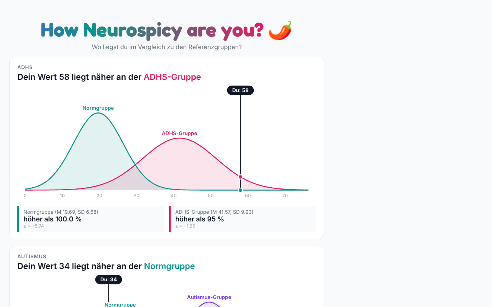

# How Neurospicy Are You? 🌶️

A playful self-assessment web app built with **Streamlit**. Participants answer
36 Likert-scale statements about attention and sensory/social experience and
immediately see where their **ADHD** and **autism** trait scores fall compared
to clinical and non-clinical reference groups.



> For fun and self-reflection only – this is not a diagnostic instrument.

## Features

- **Questionnaire** with ADHD- and autism-related items (including
  reverse-coded items) defined declaratively in
  [`website/frabo.py`](website/frabo.py).
- **Scoring** ([`website/process_responses.py`](website/process_responses.py))
  – Likert answers are converted to numbers, reverse-coded where needed and
  summed per scale.
- **Custom result visualisation**
  ([`website/render_certificate.py`](website/render_certificate.py)) – pure-Python
  SVG rendering (standard library only) of the normal distributions of each
  reference group, the participant's position, z-scores and percentiles.
- **Analysis dashboard** ([`website/full_database/`](website/full_database)) –
  pandas + Plotly/Altair views over all submissions.
- Login, per-tab session state and JSON Lines storage.

## Quick start

```bash
cd website
pip install -r requirements.txt
streamlit run app.py
```

A demo account (`demo` / `demo123`) is created on first start.

## Project structure

```
website/
├── app.py                  Streamlit UI: login, questionnaire, results
├── frabo.py                questionnaire items
├── process_responses.py    scoring
├── render_certificate.py   SVG/HTML result charts
├── auth.py / storage.py    users and JSONL answer storage
├── preview.html            static preview of the result page
├── images/                 static figures
└── full_database/          data processing + dashboard (with pytest suite)
```

Built on my reusable
[questionnaire template](https://github.com/lisgeh2/questionnaire_template).

## Tech

Python · Streamlit · SVG · pandas · Plotly · pytest
